# Домашнее задание: оркестрация Docker Compose

Рабочая станция: Ubuntu 24.04, Docker `29.9.2`, Docker Compose plugin `v5.6.1`.

## Задача 1. Образ custom-nginx

Docker и Compose plugin уже установлены. Docker Hub доступен (зеркало `daemon.json` не потребовалось).

Созданы файлы:

- [`Dockerfile`](Dockerfile) — `FROM nginx:1.29.0`, копирование своей `index.html`.
- [`index.html`](index.html) — страница «Hey, Netology» / «I will be DevOps Engineer!».

Сборка:

```bash
docker pull nginx:1.29.0
docker build -t custom-nginx:1.0.0 .
```

Публичный репозиторий на Docker Hub **не создавался**: на этой машине нет логина/`docker login`. Образ собран локально с тегом `custom-nginx:1.0.0`. Ссылка вида `https://hub.docker.com/<username>/custom-nginx/general` появится после регистрации и `docker push <user>/custom-nginx:1.0.0`.

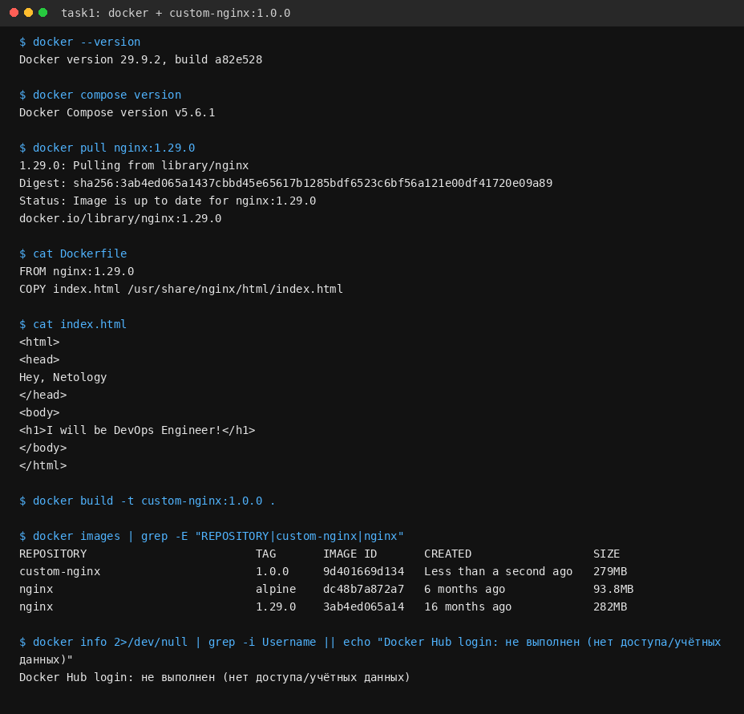

## Задача 2. Запуск контейнера

```bash
docker run -d --name IIvan-custom-nginx-t2 -p 127.0.0.1:8080:80 custom-nginx:1.0.0
docker rename IIvan-custom-nginx-t2 custom-nginx-t2
date +"%d-%m-%Y %T.%N %Z" ; sleep 0.150 ; docker ps ; ss -tlpn | grep 127.0.0.1:8080  ; docker logs custom-nginx-t2 -n1 ; docker exec -it custom-nginx-t2 base64 /usr/share/nginx/html/index.html
curl -sS http://127.0.0.1:8080
```

Индекс-страница отдаётся с `127.0.0.1:8080`.

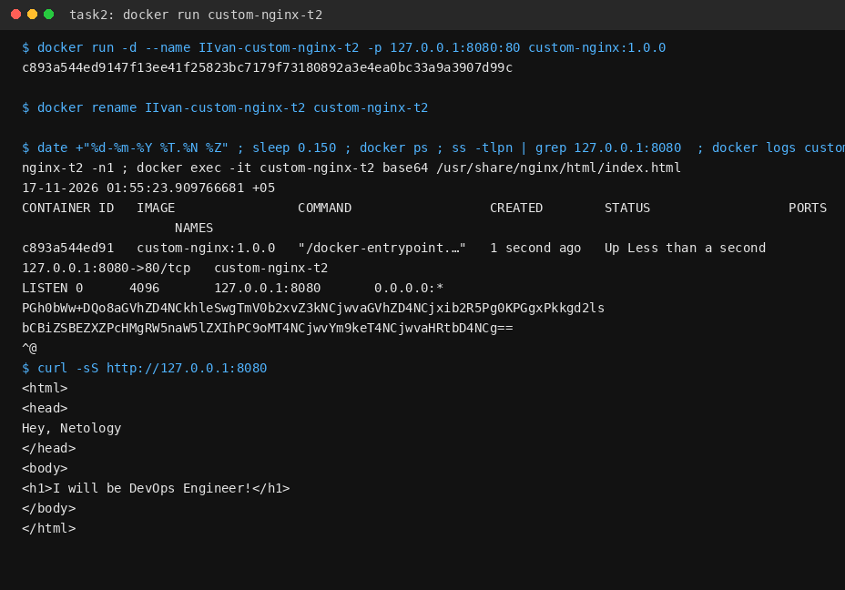

## Задача 3. attach, порт 81, удаление

Подключение к stdin/stdout/stderr контейнера:

```bash
docker attach custom-nginx-t2
```

(`docker attach --help`: attach local standard input, output, and error streams.)

После **Ctrl-C** процесс nginx (PID 1) получил `SIGINT` (проксирование сигналов включено по умолчанию, `--sig-proxy`). Для nginx это штатная остановка: контейнер перешёл в `Exited (0)`.

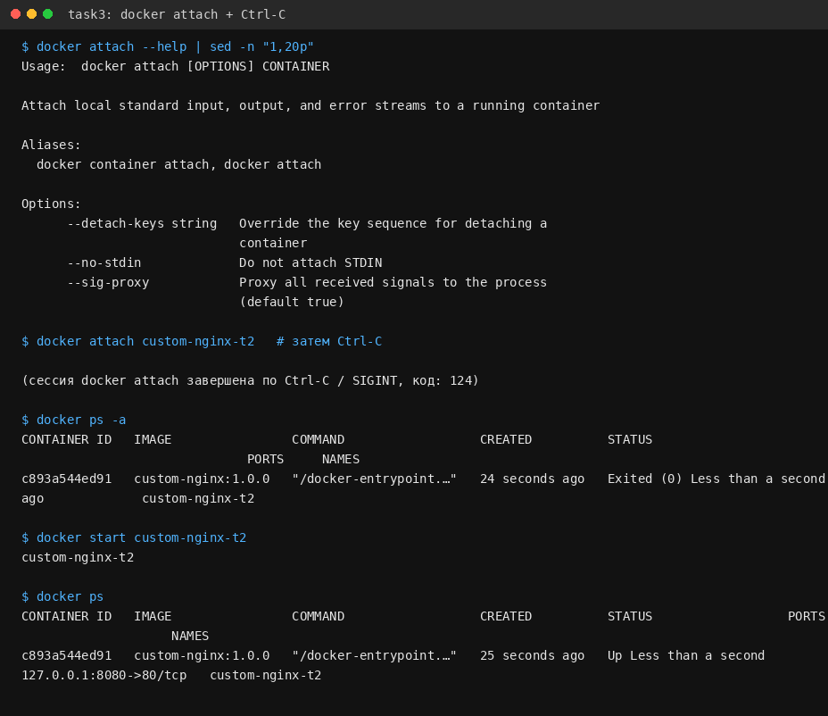

Перезапуск, вход в bash, установка `nano`, замена `listen 80` → `listen 81`, `nginx -s reload`:

- внутри контейнера `curl http://127.0.0.1:80` — соединение отклонено;
- `curl http://127.0.0.1:81` — страница отдаётся.

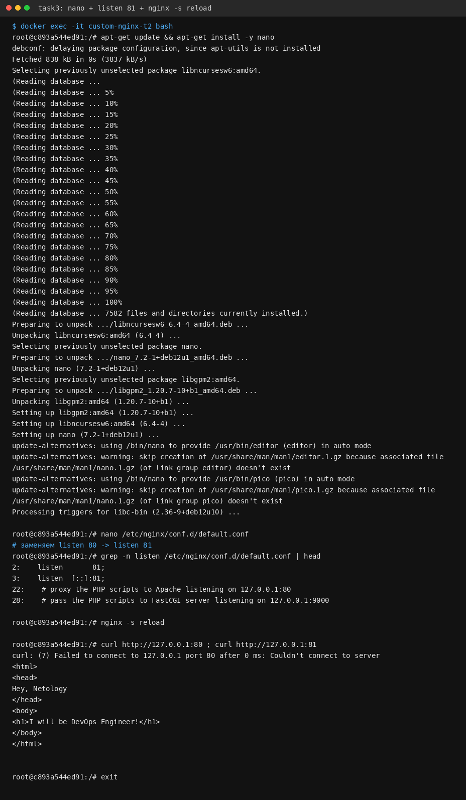

На хосте:

- `ss` показывает, что `127.0.0.1:8080` слушает docker-proxy;
- `docker port custom-nginx-t2` → `80/tcp -> 127.0.0.1:8080`;
- `curl http://127.0.0.1:8080` → `Connection reset by peer`.

**Суть проблемы:** проброс портов задаётся при `docker run` и указывает на порт **80 внутри контейнера**. Nginx после reload слушает **81**. Хостовый 8080 по-прежнему попадает в пустой порт 80, поэтому с хоста страница недоступна, хотя внутри контейнера на 81 всё работает. Поменять published ports у уже созданного контейнера штатными средствами нельзя.

Необязательное исправление без правки nginx и без удаления контейнера: внутри контейнера `socat` слушает 80 и форвардит на 81. После этого `curl http://127.0.0.1:8080` снова отдаёт индекс.

Удаление без предварительного stop:

```bash
docker rm -f custom-nginx-t2
```

(`-f, --force` — SIGKILL и удаление running-контейнера.)

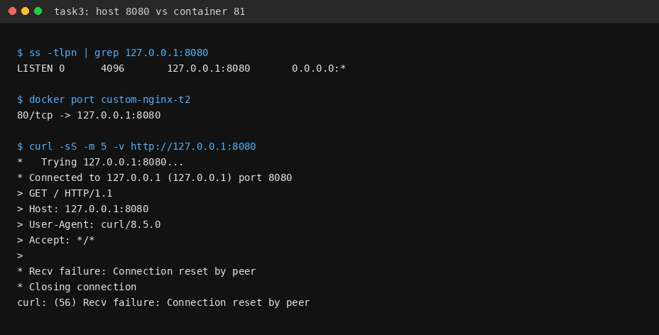

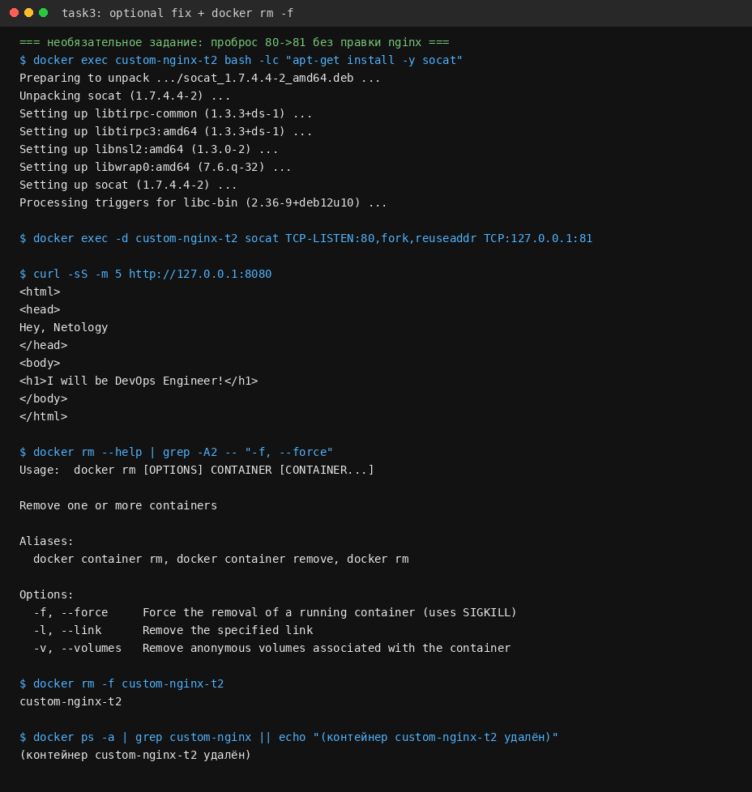

## Задача 4. Общий volume

Каталог хоста `$(pwd)` смонтирован в `/data` у `centos:7` и `debian:bookworm-slim`. Файл, созданный в centos, и файл, созданный на хосте, видны из debian — это один и тот же bind-mount.

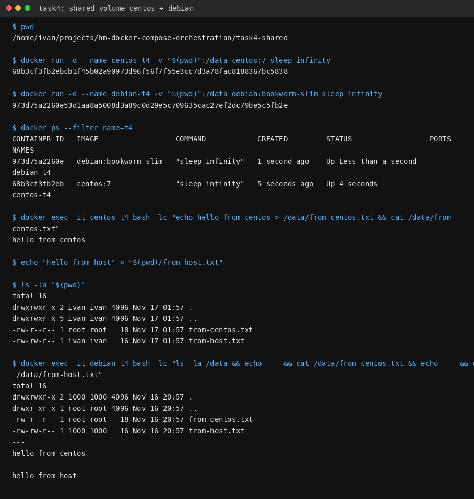

## Задача 5. Compose, registry, Portainer

Рабочий каталог: `/tmp/netology/docker/task5`. Копии манифестов: [`task5/compose.yaml`](task5/compose.yaml), [`task5/docker-compose.yaml`](task5/docker-compose.yaml).

### Какой файл взял `docker compose up -d`

Запустился **`compose.yaml`** (Portainer), а не `docker-compose.yaml` (registry).

Compose ищет каноническое имя `compose.yaml` / `compose.yml`, а `docker-compose.yaml` оставляет для совместимости. Если есть оба файла, выбирается `compose.yaml`. Об этом же пишет warning:

```text
Found multiple config files ... Using .../compose.yaml
```

Документация: [The Compose file](https://docs.docker.com/compose/compose-application-model/#the-compose-file).

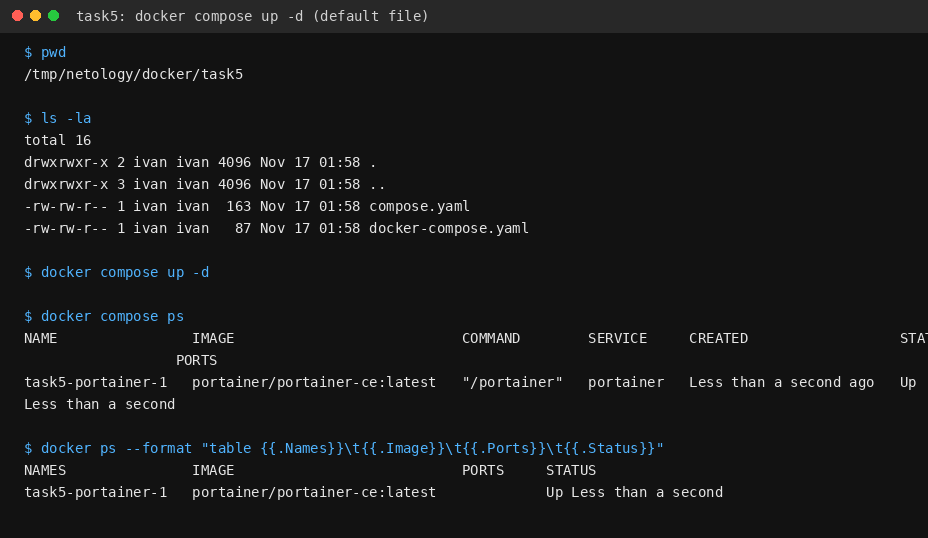

### Оба файла через `include`

В `compose.yaml` добавлено:

```yaml
include:
  - path: docker-compose.yaml
```

После повторного `docker compose up -d` поднялись и Portainer, и registry. Образ залит в локальный registry:

```bash
docker tag custom-nginx:1.0.0 127.0.0.1:5000/custom-nginx:latest
docker push 127.0.0.1:5000/custom-nginx:latest
curl -sS http://127.0.0.1:5000/v2/_catalog
# {"repositories":["custom-nginx"]}
```

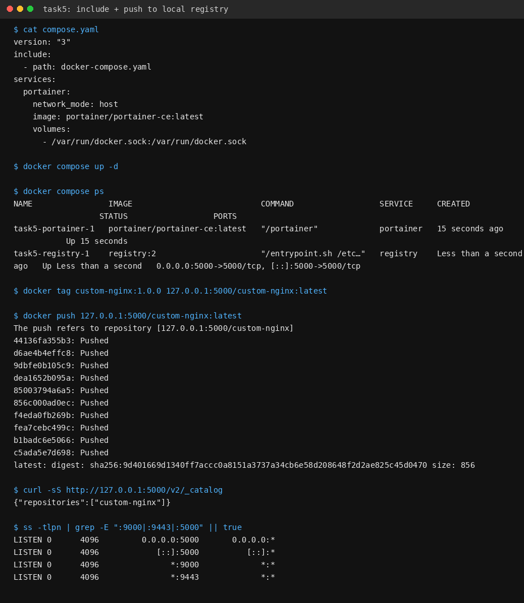

### Portainer

Начальная настройка администратора выполнена на `http://127.0.0.1:9000` (HTTPS на этой версии слушает `:9443`, HTTP — `:9000`). Выбрано окружение **local**. В Stacks задеплоен compose с образом `127.0.0.1:5000/custom-nginx` и портом `9090:80`. Проверка: `curl http://127.0.0.1:9090` отдаёт кастомную индекс-страницу.

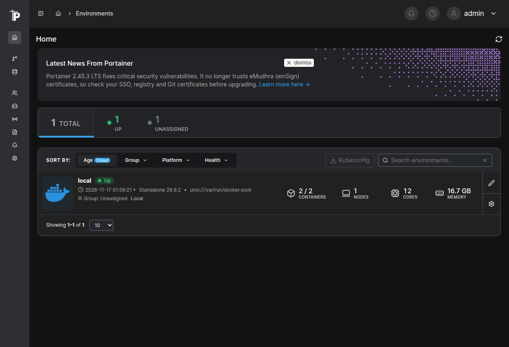

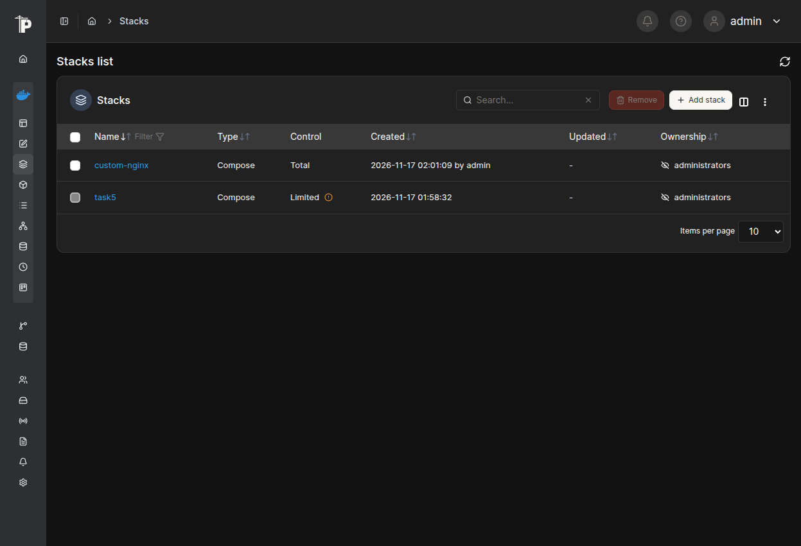

Inspect контейнера `custom-nginx-nginx-1`, вид **Tree**, поле **Config** развёрнуто (от `AppArmorProfile` до `Driver`):

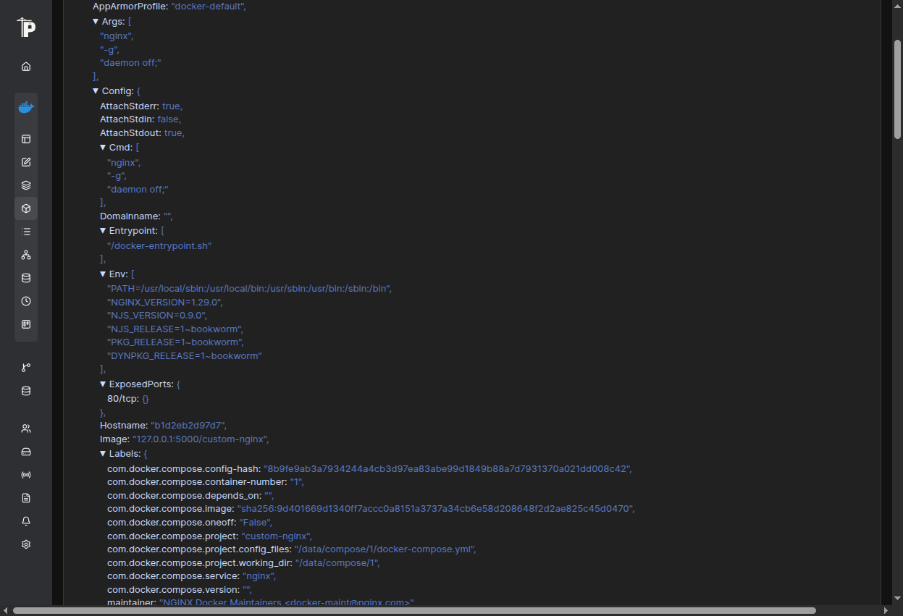

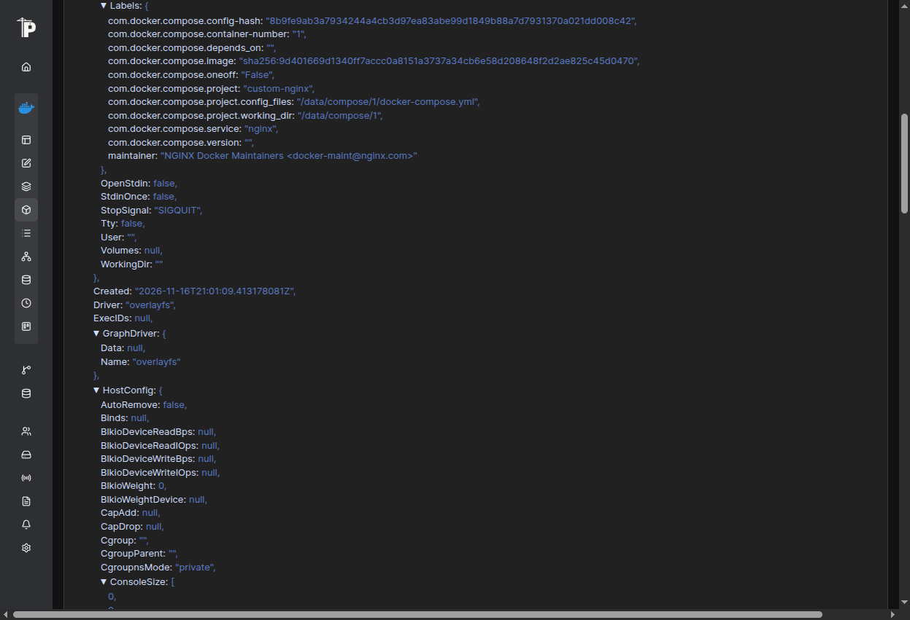

### Удаление манифеста и orphan warning

После `rm compose.yaml` команда `docker compose up -d` берёт оставшийся `docker-compose.yaml` (только `registry`). Предупреждение:

```text
Found orphan containers (task5-portainer-1) for this project.
... run this command with the --remove-orphans flag
```

**Суть:** проект Compose по-прежнему называется `task5`, но в текущем файле сервиса `portainer` уже нет. Контейнер Portainer для Compose — «сирота» (orphan): он был создан этим проектом, но больше не описан. Предложенное действие:

```bash
docker compose up -d --remove-orphans
```

Остановка проекта **одной** командой:

```bash
docker compose down
```

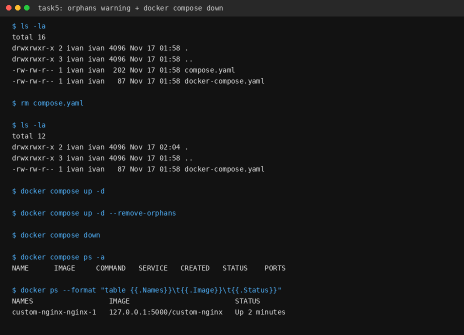
